# OVS Entity-Relationship (ER) Diagram & Structural Analysis (Phase 8.1.2 Hardened)

## 1. Complete Entity-Relationship Diagram (Mermaid)

```mermaid
erDiagram
    %% =========================================================================
    %% GEOGRAPHY ENTITIES (WITH COMPOSITE INTEGRITY)
    %% =========================================================================
    State ||--o{ District : "contains"
    State ||--o{ ParliamentaryConstituency : "contains"
    State ||--o{ AssemblyConstituency : "contains"
    District ||--o{ AssemblyConstituency : "contains (composite district_id, state_id)"
    ParliamentaryConstituency ||--o{ AssemblyConstituency : "parent of (composite parent_pc, state_id)"

    State {
        string id PK "e.g. WB, MH, DL"
        string name
        string type "STATE | UNION_TERRITORY"
        string capital
        int total_lok_sabha_seats
        int total_assembly_seats
        string metadata_source "VERIFIED_OFFICIAL"
    }

    District {
        string id PK "e.g. DIST-WB-KOL"
        string state_id FK "UNIQUE (id, state_id)"
        string name
        string headquarters
    }

    ParliamentaryConstituency {
        string id PK "e.g. PC-WB-KOLKATA-SOUTH"
        string state_id FK "UNIQUE (id, state_id)"
        int constituency_number
        string name
        string reservation_type "GENERAL | SC | ST"
        int total_voters
    }

    AssemblyConstituency {
        string id PK "e.g. AC-WB-BHABANIPUR"
        string state_id FK
        string district_id FK "FK (district_id, state_id)"
        string parent_parliamentary_constituency_id FK "FK (parent_pc, state_id)"
        int constituency_number
        string name
        string reservation_type "GENERAL | SC | ST"
        int total_voters
    }

    %% =========================================================================
    %% USER & VOTER MANAGEMENT
    %% =========================================================================
    User ||--o| VoterProfile : "authenticates"
    User ||--o| AdminUser : "authenticates"
    User ||--o{ UserSession : "establishes"

    VoterProfile }o--|| State : "resides in"
    VoterProfile }o--|| District : "FK (district_id, state_id)"
    VoterProfile }o--|| ParliamentaryConstituency : "FK (parliamentary_constituency_id, state_id)"
    VoterProfile }o--|| AssemblyConstituency : "FK (assembly_constituency_id, parliamentary_constituency_id)"
    VoterProfile ||--o{ VoterNotification : "receives"
    VoterProfile ||--o{ DemoParticipation : "participates in"

    User {
        uuid id PK
        string user_type "VOTER | ADMIN"
        string identifier UK "EPIC or Officer Code"
        string password_hash
        boolean is_active
        int failed_login_attempts
        datetime lockout_until
    }

    VoterProfile {
        uuid id PK
        uuid user_id FK, UK
        string epic_number UK "e.g. WBX1234567"
        string full_name
        date date_of_birth
        string gender
        string mobile
        string email
        string state_id FK
        string district_id FK
        string parliamentary_constituency_id FK
        string assembly_constituency_id FK
    }

    UserSession {
        string id PK
        uuid user_id FK
        string ip_address
        datetime expires_at
    }

    AuthChallenge {
        uuid id PK
        string identifier "Target EPIC or Officer Code"
        string otp_hash
        int attempts
        datetime expires_at
        datetime consumed_at
    }

    %% =========================================================================
    %% ELECTIONS & CONSTITUENCIES
    %% =========================================================================
    Election ||--o{ ElectionConstituency : "includes"
    Election ||--o{ ElectionLifecycleHistory : "records"
    Election ||--o{ CandidateNomination : "contested in"
    Election ||--o{ CountingSession : "counted in"
    Election ||--o{ DemoParticipation : "receives demo participation"
    Election ||--o{ Announcement : "targets"
    Election ||--o{ AdminElectionScope : "scoped to"
    State ||--o{ Election : "hosts (for Assembly)"

    Election {
        string id PK "e.g. LS-2029, WB-ASSEMBLY-2029"
        string name
        string type "LOK_SABHA | STATE_ASSEMBLY"
        int year
        string state_id FK "Null for Lok Sabha, NOT NULL for Assembly"
        string status "UPCOMING | NOMINATION_OPEN | POLLING_ACTIVE | COUNTING | RESULTS_DECLARED"
        date polling_start_date
        date polling_end_date
        date counting_date
        date result_date
        date simulation_clock_date
    }

    ElectionConstituency {
        uuid id PK
        string election_id FK
        string constituency_type "PARLIAMENTARY | ASSEMBLY"
        string parliamentary_constituency_id FK "Partial UK (election_id, PC)"
        string assembly_constituency_id FK "Partial UK (election_id, AC)"
    }

    ElectionLifecycleHistory {
        uuid id PK
        string election_id FK
        string from_status
        string to_status
        datetime changed_at
        string note
    }

    %% =========================================================================
    %% PARTIES & CANDIDATES
    %% =========================================================================
    PoliticalParty ||--o{ Candidate : "sponsors"
    PoliticalParty ||--o{ CandidateTally : "referenced by composite FK"
    Candidate ||--o{ CandidateNomination : "files (max 2 per RPA 1951 s.33(7))"
    Candidate ||--o{ CandidateTally : "receives votes (FK candidate_id, party_id)"

    PoliticalParty {
        string id PK "e.g. PARTY-BJP, PARTY-INC"
        string name
        string abbreviation
        string party_type "NATIONAL | STATE | INDEPENDENT"
        string symbol_name
        string status "ACTIVE | INACTIVE"
    }

    Candidate {
        string id PK "e.g. CAND-LS29-KRN-1"
        string party_id FK "UNIQUE (id, party_id)"
        string full_name
        int age
        string gender
        int criminal_cases
        bigint assets_declared
        bigint liabilities_declared
    }

    CandidateNomination {
        uuid id PK
        string candidate_id FK
        string election_id FK
        string constituency_type "PARLIAMENTARY | ASSEMBLY"
        string parliamentary_constituency_id FK "Partial UK (candidate, election, PC)"
        string assembly_constituency_id FK "Partial UK (candidate, election, AC)"
        string status "SUBMITTED | APPROVED | REJECTED | WITHDRAWN"
        datetime scrutiny_date
        string scrutiny_note
    }

    %% =========================================================================
    %% ADMINISTRATIVE RBAC, SCOPES & AUDIT
    %% =========================================================================
    AdminUser ||--o{ AdminActionLog : "performs"
    AdminUser ||--o{ AdminElectionScope : "assigned scopes"
    AdminUser }o--o| State : "assigned state scope"

    AdminUser {
        uuid id PK
        uuid user_id FK, UK
        string officer_code UK "e.g. ECI-SUPER-001"
        string full_name
        string role "SUPER_ADMIN | NATIONAL_ADMIN | STATE_ADMIN | ELECTION_OFFICER | READ_ONLY_AUDITOR"
        string assigned_state_id FK "Scope for STATE_ADMIN"
        boolean is_active
    }

    AdminElectionScope {
        uuid id PK
        uuid admin_user_id FK
        string election_id FK "UNIQUE (admin_user_id, election_id)"
        datetime assigned_at
        uuid assigned_by_admin_id FK
    }

    AdminActionLog {
        uuid id PK
        uuid admin_user_id FK
        string action_type "CREATE_ELECTION | ADVANCE_ROUND | etc"
        string domain "ELECTION | CANDIDATE | RESULT"
        string target_entity_id
        jsonb details "Sanitized, no secrets"
        datetime timestamp
    }

    %% =========================================================================
    %% DEMO PARTICIPATION (STRICTLY DECOUPLED FROM BALLOT CHOICES)
    %% =========================================================================
    DemoParticipation {
        uuid id PK
        uuid voter_id FK "Voter who completed demo"
        string election_id FK "Election participated in"
        string status "VOTED"
        string demo_reference "DEMO-LS-000001"
        string reference_id "DEMO-REF-LS2029-VOTER001"
        datetime participated_at "Simulated demo timestamp"
        datetime recorded_at "Actual server timestamp"
    }

    %% =========================================================================
    %% COUNTING SIMULATION & RESULTS (INDEPENDENT DATASET)
    %% =========================================================================
    CountingSession ||--o{ CountingRound : "advances"
    CountingSession ||--o{ CandidateTally : "contains (trigger-bound to APPROVED nomination)"
    CountingSession ||--o{ ResultCorrectionHistory : "records"
    CountingSession }o--o| Candidate : "winner (validated nomination)"
    CountingSession }o--o| Candidate : "runner-up (validated nomination)"

    CountingSession {
        string id PK "RESULT-LS-2029-WB-PC-KOLKATA-SOUTH"
        string election_id FK
        string constituency_type "PARLIAMENTARY | ASSEMBLY"
        string parliamentary_constituency_id FK "Partial UK (election_id, PC)"
        string assembly_constituency_id FK "Partial UK (election_id, AC)"
        string status "10-state machine (DRAFT to PUBLISHED)"
        int total_configured_rounds
        int current_round
        int total_counted_votes
        int nota_votes
        string winner_candidate_id FK
        string runner_up_candidate_id FK
        int victory_margin
        boolean is_published
    }

    CountingRound {
        uuid id PK
        string session_id FK
        int round_number
        int round_votes
        int cumulative_votes
        string leading_candidate_id FK
        int lead_margin
        datetime processed_at
    }

    CandidateTally {
        uuid id PK
        string session_id FK
        string candidate_id FK "Composite FK (candidate_id, party_id)"
        string party_id FK
        int votes
        decimal vote_share_percentage
    }

    ResultCorrectionHistory {
        uuid id PK
        string session_id FK
        jsonb previous_state
        jsonb corrected_state
        string reason
        datetime corrected_at
    }

    %% =========================================================================
    %% ANNOUNCEMENTS & NOTIFICATIONS
    %% =========================================================================
    Announcement }o--o| State : "target state"
    Announcement }o--o| Election : "target election"
    Announcement }o--o| ParliamentaryConstituency : "target PC"
    Announcement }o--o| AssemblyConstituency : "target AC"

    Announcement {
        string id PK "ANN-001"
        string title
        string category "GENERAL_INFO | ELECTION_SCHEDULE | RESULTS"
        string target_audience "ALL_VOTERS | SPECIFIC_STATE | SPECIFIC_ELECTION | SPECIFIC_CONSTITUENCY"
        string target_state_id FK
        string target_election_id FK
        string target_constituency_type "PARLIAMENTARY | ASSEMBLY | NULL"
        string target_parliamentary_constituency_id FK
        string target_assembly_constituency_id FK
        date publication_date
        date expiry_date
        string status "PUBLISHED | ARCHIVED"
    }

    VoterNotification {
        string id PK "NOTIF-001"
        uuid voter_id FK
        string type "ELECTION_ANNOUNCEMENT | REMINDER"
        string title
        string message
        boolean is_read
        datetime timestamp
    }
```

---

## 2. Plain-Language Explanation of Hardened Structural Invariants

### 2.1 Geographic Hierarchy Integrity & Dual-Constituency Mapping
- **Composite Foreign Key Containment**:
  - `AssemblyConstituency` enforces that its district and its parent PC belong to the same state via `FOREIGN KEY (district_id, state_id) REFERENCES districts(id, state_id)` and `FOREIGN KEY (parent_parliamentary_constituency_id, state_id) REFERENCES parliamentary_constituencies(id, state_id)`.
  - `VoterProfile` enforces that a voter's assigned AC strictly belongs to their assigned PC via `FOREIGN KEY (assembly_constituency_id, parliamentary_constituency_id) REFERENCES assembly_constituencies(id, parent_parliamentary_constituency_id)`.
  - It is mathematically and relationally impossible at the database level for an AC to belong to a PC in another state, or for a voter to be assigned to an AC that is outside their assigned PC.

### 2.2 Statutory Candidate Nomination Uniqueness (RPA 1951 s.33(7))
- Section 33(7) of the *Representation of the People Act, 1951* permits a candidate in India to contest from up to two constituencies in an election.
- The previous `UNIQUE (candidate_id, election_id)` constraint was overly restrictive.
- In Phase 8.1.2, uniqueness is enforced per candidate, election, and constituency via Partial Unique Indexes:
  `uq_nomination_candidate_election_pc` and `uq_nomination_candidate_election_ac`.
- The statutory ceiling of at most 2 active nominations per candidate per election is enforced by the `trg_verify_candidate_nomination_compatibility` trigger.

### 2.3 Candidate Nomination & Counting Tally Invariant
- Every tally row in `candidate_tallies` is verified by trigger `trg_verify_candidate_tally_nomination`:
  1. The candidate must hold an `APPROVED` nomination in `candidate_nominations` for that exact election and constituency.
  2. The candidate's registered political party must match `party_id` (enforced both by composite foreign key `(candidate_id, party_id)` and trigger).
  3. NOTA cannot be recorded as a candidate; it is tracked independently via `counting_sessions.nota_votes`.
  4. Winner and runner-up declared in `counting_sessions` must also hold `APPROVED` nominations in that constituency.

### 2.4 Hardened Publication State Machine
- Result publication requires transition through an approved review stage:
  `DRAFT` → `COUNTING_IN_PROGRESS` → `COUNTING_PAUSED` / `COUNTING_COMPLETED` → `RESULT_READY_FOR_REVIEW` → `PUBLISHED`.
- Direct insertion of `is_published = TRUE` or `status = 'PUBLISHED'` is blocked on `INSERT`.
- Publication from `DRAFT` or directly from `COUNTING_COMPLETED` is rejected on `UPDATE`.
- All configured rounds must be completed (`current_round >= total_configured_rounds`).
- Results in `TIED` status cannot be published without documented tie-break resolution.
- Enforced by trigger `trg_verify_counting_session_publication` in `CUSTOM_DATABASE_INTEGRITY.sql`.

### 2.5 Strict Decoupling of Demo Participation
- The `demo_participations` table contains **zero candidate or party choice columns**.
- Counting sessions and candidate tallies are calculated from independent seed and simulation data, guaranteeing constitutional ballot secrecy by structural design.
