# OVS Entity-Relationship (ER) Diagram & Structural Analysis (Phase 8.1.1 Corrected)

## 1. Complete Entity-Relationship Diagram (Mermaid)

```mermaid
erDiagram
    %% =========================================================================
    %% GEOGRAPHY ENTITIES (WITH COMPOSITE INTEGRITY)
    %% =========================================================================
    State ||--o{ District : "contains"
    State ||--o{ ParliamentaryConstituency : "contains"
    State ||--o{ AssemblyConstituency : "contains"
    District ||--o{ AssemblyConstituency : "contains (composite districtId, stateId)"
    ParliamentaryConstituency ||--o{ AssemblyConstituency : "parent of (composite parentPC, stateId)"

    State {
        string id PK "e.g. WB, MH, DL"
        string name
        string type "STATE | UNION_TERRITORY"
        string capital
        int totalLokSabhaSeats
        int totalAssemblySeats
        string metadataSource "VERIFIED_OFFICIAL"
    }

    District {
        string id PK "e.g. DIST-WB-KOL"
        string stateId FK "UNIQUE (id, stateId)"
        string name
        string headquarters
    }

    ParliamentaryConstituency {
        string id PK "e.g. PC-WB-KOLKATA-SOUTH"
        string stateId FK "UNIQUE (id, stateId)"
        int constituencyNumber
        string name
        string reservationType "GENERAL | SC | ST"
        int totalVoters
    }

    AssemblyConstituency {
        string id PK "e.g. AC-WB-BHABANIPUR"
        string stateId FK
        string districtId FK "FK (districtId, stateId)"
        string parentParliamentaryConstituencyId FK "FK (parentPC, stateId)"
        int constituencyNumber
        string name
        string reservationType "GENERAL | SC | ST"
        int totalVoters
    }

    %% =========================================================================
    %% USER & VOTER MANAGEMENT
    %% =========================================================================
    User ||--o| VoterProfile : "authenticates"
    User ||--o| AdminUser : "authenticates"
    User ||--o{ UserSession : "establishes"

    VoterProfile }o--|| State : "resides in"
    VoterProfile }o--|| District : "FK (districtId, stateId)"
    VoterProfile }o--|| ParliamentaryConstituency : "FK (parliamentaryConstituencyId, stateId)"
    VoterProfile }o--|| AssemblyConstituency : "FK (assemblyConstituencyId, parliamentaryConstituencyId)"
    VoterProfile ||--o{ VoterNotification : "receives"
    VoterProfile ||--o{ DemoParticipation : "participates in"

    User {
        uuid id PK
        string userType "VOTER | ADMIN"
        string identifier UK "EPIC or Officer Code"
        string passwordHash
        boolean isActive
        int failedLoginAttempts
        datetime lockoutUntil
    }

    VoterProfile {
        uuid id PK
        uuid userId FK, UK
        string epicNumber UK "e.g. WBX1234567"
        string fullName
        date dateOfBirth
        string gender
        string mobile
        string email
        string stateId FK
        string districtId FK
        string parliamentaryConstituencyId FK
        string assemblyConstituencyId FK
    }

    UserSession {
        string id PK
        uuid userId FK
        string ipAddress
        datetime expiresAt
    }

    AuthChallenge {
        uuid id PK
        string identifier "Target EPIC or Officer Code"
        string otpHash
        int attempts
        datetime expiresAt
        datetime consumedAt
    }

    %% =========================================================================
    %% ELECTIONS & CONSTITUENCIES
    %% =========================================================================
    Election ||--o{ ElectionConstituency : "includes"
    Election ||--o{ ElectionLifecycleHistory : "records"
    Election ||--o{ CandidateNomination : "contested in"
    Election ||--o{ CountingSession : "counted in"
    Election ||--o{ DemoParticipation : "receives demo participation"
    Election ||--o{ Announcement : "targets"
    Election ||--o{ AdminElectionScope : "scoped to"
    State ||--o{ Election : "hosts (for Assembly)"

    Election {
        string id PK "e.g. LS-2029, WB-ASSEMBLY-2029"
        string name
        string type "LOK_SABHA | STATE_ASSEMBLY"
        int year
        string stateId FK "Null for Lok Sabha, NOT NULL for Assembly"
        string status "UPCOMING | NOMINATION_OPEN | POLLING_ACTIVE | COUNTING_ACTIVE | RESULTS_DECLARED"
        date pollingStartDate
        date pollingEndDate
        date countingDate
        date resultDate
        date simulationClockDate
    }

    ElectionConstituency {
        uuid id PK
        string electionId FK
        string constituencyType "PARLIAMENTARY | ASSEMBLY"
        string parliamentaryConstituencyId FK "Partial UK (electionId, PC)"
        string assemblyConstituencyId FK "Partial UK (electionId, AC)"
    }

    ElectionLifecycleHistory {
        uuid id PK
        string electionId FK
        string fromStatus
        string toStatus
        datetime changedAt
        string note
    }

    %% =========================================================================
    %% PARTIES & CANDIDATES
    %% =========================================================================
    PoliticalParty ||--o{ Candidate : "sponsors"
    PoliticalParty ||--o{ CandidateTally : "referenced by composite FK"
    Candidate ||--o{ CandidateNomination : "files"
    Candidate ||--o{ CandidateTally : "receives votes (FK candidateId, partyId)"

    PoliticalParty {
        string id PK "e.g. PARTY-BJP, PARTY-INC"
        string name
        string abbreviation
        string partyType "NATIONAL | STATE | INDEPENDENT"
        string symbolName
        string status "ACTIVE | INACTIVE"
    }

    Candidate {
        string id PK "e.g. CAND-LS29-KRN-1"
        string partyId FK "UNIQUE (id, partyId)"
        string fullName
        int age
        string gender
        int criminalCases
        bigint assetsDeclared
        bigint liabilitiesDeclared
    }

    CandidateNomination {
        uuid id PK
        string candidateId FK
        string electionId FK
        string constituencyType "PARLIAMENTARY | ASSEMBLY"
        string parliamentaryConstituencyId FK "Partial UK (election, PC, candidate)"
        string assemblyConstituencyId FK "Partial UK (election, AC, candidate)"
        string status "SUBMITTED | APPROVED | REJECTED | WITHDRAWN"
        datetime scrutinyDate
        string scrutinyNote
    }

    %% =========================================================================
    %% ADMINISTRATIVE RBAC, SCOPES & AUDIT
    %% =========================================================================
    AdminUser ||--o{ AdminActionLog : "performs"
    AdminUser ||--o{ AdminElectionScope : "assigned scopes"
    AdminUser }o--o| State : "assigned state scope"

    AdminUser {
        uuid id PK
        uuid userId FK, UK
        string officerCode UK "e.g. ECI-SUPER-001"
        string fullName
        string role "SUPER_ADMIN | NATIONAL_ADMIN | STATE_ADMIN | ELECTION_OFFICER | READ_ONLY_AUDITOR"
        string assignedStateId FK "Scope for STATE_ADMIN"
        boolean isActive
    }

    AdminElectionScope {
        uuid id PK
        uuid adminUserId FK
        string electionId FK "UNIQUE (adminUserId, electionId)"
        datetime assignedAt
        uuid assignedByAdminId FK
    }

    AdminActionLog {
        uuid id PK
        uuid adminUserId FK
        string actionType "CREATE_ELECTION | ADVANCE_ROUND | etc"
        string domain "ELECTION | CANDIDATE | RESULT"
        string targetEntityId
        jsonb details "Sanitized, no secrets"
        datetime timestamp
    }

    %% =========================================================================
    %% DEMO PARTICIPATION (STRICTLY DECOUPLED FROM BALLOT CHOICES)
    %% =========================================================================
    DemoParticipation {
        uuid id PK
        uuid voterId FK "Voter who completed demo"
        string electionId FK "Election participated in"
        string status "VOTED"
        string demoReference "DEMO-LS-000001"
        string referenceId "DEMO-REF-LS2029-VOTER001"
        datetime participatedAt "Simulated demo timestamp"
        datetime recordedAt "Actual server timestamp"
    }

    %% =========================================================================
    %% COUNTING SIMULATION & RESULTS (INDEPENDENT DATASET)
    %% =========================================================================
    CountingSession ||--o{ CountingRound : "advances"
    CountingSession ||--o{ CandidateTally : "contains"
    CountingSession ||--o{ ResultCorrectionHistory : "records"
    CountingSession }o--o| Candidate : "winner"
    CountingSession }o--o| Candidate : "runner-up"

    CountingSession {
        string id PK "RESULT-LS-2029-WB-PC-KOLKATA-SOUTH"
        string electionId FK
        string constituencyType "PARLIAMENTARY | ASSEMBLY"
        string parliamentaryConstituencyId FK "Partial UK (electionId, PC)"
        string assemblyConstituencyId FK "Partial UK (electionId, AC)"
        string status "DRAFT | COUNTING_IN_PROGRESS | COUNTING_PAUSED | COUNTING_COMPLETED | RESULT_READY_FOR_REVIEW | PUBLISHED | TIED | UNDER_REVIEW | CORRECTED | UNPUBLISHED"
        int totalConfiguredRounds
        int currentRound
        int totalCountedVotes
        int notaVotes
        string winnerCandidateId FK
        string runnerUpCandidateId FK
        int victoryMargin
        boolean isPublished
    }

    CountingRound {
        uuid id PK
        string sessionId FK
        int roundNumber
        int roundVotes
        int cumulativeVotes
        string leadingCandidateId FK
        int leadMargin
        datetime processedAt
    }

    CandidateTally {
        uuid id PK
        string sessionId FK
        string candidateId FK "Composite FK (candidateId, partyId)"
        string partyId FK
        int votes
        decimal voteSharePercentage
    }

    ResultCorrectionHistory {
        uuid id PK
        string sessionId FK
        jsonb previousState
        jsonb correctedState
        string reason
        datetime correctedAt
    }

    %% =========================================================================
    %% ANNOUNCEMENTS & NOTIFICATIONS
    %% =========================================================================
    Announcement }o--o| State : "target state"
    Announcement }o--o| Election : "target election"
    Announcement }o--o| ParliamentaryConstituency : "target PC"
    Announcement }o--o| AssemblyConstituency : "target AC"

    Announcement {
        string id PK "ANN-001"
        string title
        string category "GENERAL_INFO | ELECTION_SCHEDULE | RESULTS"
        string targetAudience "ALL_VOTERS | SPECIFIC_STATE | SPECIFIC_ELECTION | SPECIFIC_CONSTITUENCY"
        string targetStateId FK
        string targetElectionId FK
        string targetConstituencyType "PARLIAMENTARY | ASSEMBLY | NULL"
        string targetParliamentaryConstituencyId FK
        string targetAssemblyConstituencyId FK
        date publicationDate
        date expiryDate
        string status "PUBLISHED | ARCHIVED"
    }

    VoterNotification {
        string id PK "NOTIF-001"
        uuid voterId FK
        string type "ELECTION_ANNOUNCEMENT | REMINDER"
        string title
        string message
        boolean isRead
        datetime timestamp
    }
```



---

## 2. Plain-Language Explanation of Key Structural Relationships

### 2.1 Geographic Hierarchy Integrity & Dual-Constituency Mapping
- **States & UTs**: A `State` acts as the root boundary. It has child `District` records and child `ParliamentaryConstituency` (PC) records.
- **Parent PC to Assembly Constituency (AC)**: An `AssemblyConstituency` belongs to a `State` and a `District`, and explicitly references a `parentParliamentaryConstituencyId`. 
- **Enforced Geographic Consistency via Composite Foreign Keys**:
  - `AssemblyConstituency` enforces that its district and its parent PC belong to the same state via `FOREIGN KEY (districtId, stateId) REFERENCES districts(id, stateId)` and `FOREIGN KEY (parentParliamentaryConstituencyId, stateId) REFERENCES parliamentary_constituencies(id, stateId)`.
  - `VoterProfile` enforces that a voter's assigned AC strictly belongs to their assigned PC via `FOREIGN KEY (assemblyConstituencyId, parliamentaryConstituencyId) REFERENCES assembly_constituencies(id, parentParliamentaryConstituencyId)`.
  - It is mathematically and relationally impossible at the database level for an AC to belong to a PC in another state, or for a voter to be assigned to an AC that is outside their assigned PC.

### 2.2 Constituency Type Integrity & Nullable Composite Uniqueness
- **Mutual Exclusivity**: `ElectionConstituency`, `CandidateNomination`, and `CountingSession` hold either a Parliamentary Constituency or an Assembly Constituency, never both and never neither. This is enforced via PostgreSQL `CHECK` constraints:
  ```sql
  CHECK (
    (constituency_type = 'PARLIAMENTARY' AND parliamentary_constituency_id IS NOT NULL AND assembly_constituency_id IS NULL)
    OR
    (constituency_type = 'ASSEMBLY' AND assembly_constituency_id IS NOT NULL AND parliamentary_constituency_id IS NULL)
  );
  ```
- **PostgreSQL Partial Unique Indexes**: In standard SQL-92, `NULL != NULL`, meaning ordinary composite `UNIQUE (electionId, parliamentaryConstituencyId, assemblyConstituencyId)` constraints allow duplicate rows when one column is NULL. In OVS, this is resolved by using PostgreSQL Partial Unique Indexes (`CREATE UNIQUE INDEX ... WHERE parliamentary_constituency_id IS NOT NULL`).

### 2.3 Candidate-Party Consistency & Tally Integrity
- In `candidates`, a composite unique key `UNIQUE (id, partyId)` is established.
- In `candidate_tallies`, vote counts are bound by the composite foreign key `FOREIGN KEY (candidateId, partyId) REFERENCES candidates(id, partyId)`.
- This ensures that a candidate's votes cannot be recorded under a different political party than their registered party.
- NOTA (None of the Above) is modeled as a first-class citizen in `counting_sessions.notaVotes`, separate from individual candidate tallies.

### 2.4 User Authentication vs. Profile Separation
- To adhere to privacy-by-design, credentials and session data live in the `User` and `UserSession` tables.
- A `User` has a 1-to-1 relationship with either a `VoterProfile` (for citizen voters) or an `AdminUser` (for election commission officers).
- Authentication mechanisms never query or expose electoral choices or ballot records.

### 2.5 Strict Separation: Demo Participation vs. Counting Engine
- **`DemoParticipation` Table**: Contains **only** `{ voterId, electionId, status: 'VOTED', demoReference, referenceId, participatedAt, recordedAt }`.
  - There is a unique constraint on `(voterId, electionId)` ensuring that a voter can only participate once per election.
  - **Zero Choice Persistence**: There is **no foreign key** to `candidates`, `political_parties`, or any selection column.
- **`CountingSession` and `CandidateTally` Tables**:
  - Counting sessions are linked to an `(electionId, constituencyId)`.
  - The votes counted in `CandidateTally` originate from deterministic simulation seed data (`INITIAL_RESULTS`) or round-by-round admin simulations, **completely decoupled** from voter records.
  - No database query or join can link a voter's demo participation entry to a candidate vote tally.

### 2.6 Normalized Administrative Scoping (RBAC)
- An `AdminUser` is assigned a `role` (`SUPER_ADMIN`, `NATIONAL_ADMIN`, `STATE_ADMIN`, `ELECTION_OFFICER`, `READ_ONLY_AUDITOR`).
- `STATE_ADMIN` has a foreign key to `assignedStateId`, restricting authorization to elections, constituencies, and candidates within that specific state.
- `ELECTION_OFFICER` has normalized foreign key mappings via `AdminElectionScope` (`admin_election_scopes` table), replacing unstructured JSON or text arrays.
- All mutating administrative actions are logged in `AdminActionLog` with sanitized JSON details.

### 2.7 Typed Announcement Targeting
- Announcements targeting constituencies explicitly declare `targetConstituencyType` (`PARLIAMENTARY` or `ASSEMBLY`) and reference `parliamentary_constituencies.id` or `assembly_constituencies.id` with valid foreign keys.
- Enforced by a CHECK constraint ensuring that targeting a constituency always points to a verified constituency record.
