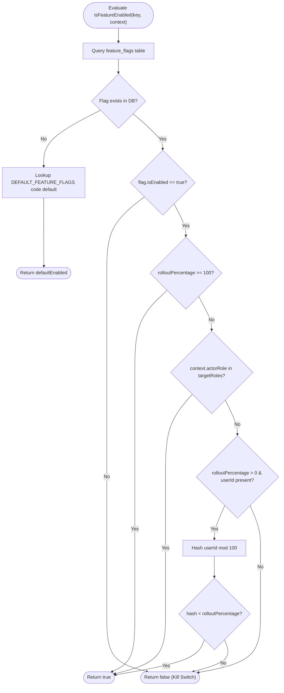

# Feature Flags Specification & Evaluation Engine

## 1. Overview
The OVS Feature Flags subsystem allows operational administrators to selectively enable, disable, and gradually roll out platform features without requiring application deployments or service restarts. The system is designed with fail-closed security semantics: if an unknown flag is queried, or if the database connectivity is unavailable, the evaluation immediately falls back to safe code defaults or denies access (`false`).

---

## 2. Pre-Registered Feature Catalog

| Flag Key | Description | Default State | Default Rollout | Target Roles |
| :--- | :--- | :--- | :--- | :--- |
| `feat.advanced_analytics` | Deep analytics dashboards and turnout breakdowns | Enabled | 100% | All Roles |
| `feat.voter_receipt_download` | Voter participation confirmation PDF/receipt | Enabled | 100% | All Roles |
| `feat.email_notification_delivery` | Outbound email dispatcher for notifications | Enabled (Restricted) | 0% | `SUPER_ADMIN`, `NATIONAL_ADMIN` |
| `feat.multi_round_counting_simulation` | Multi-round synthetic tally processing | Enabled | 100% | All Roles |
| `feat.announcement_scheduler` | Future-scheduled announcement publishing | Enabled | 100% | All Roles |
| `feat.maintenance_mode_interception` | System maintenance middleware request interception | Enabled | 100% | All Roles |

---

## 3. Evaluation Logic & Algorithm

Evaluation follows a multi-tier hierarchy:

1. **Kill Switch Evaluation**:
   If `isEnabled === false`, the feature is unconditionally inactive for all users regardless of rollout percentage or target roles.
2. **Global Rollout (100%)**:
   If `rolloutPercentage >= 100`, the feature is active for all callers.
3. **Role-Targeted Canary Testing**:
   If the evaluation context provides an `actorRole` and that role is explicitly listed in `targetRoles`, access is granted (`true`). This allows early preview access for administrators while rollout is set to 0%.
4. **Deterministic Percentage Hashing**:
   If `rolloutPercentage > 0` and a `userId` is present in the context, a deterministic hash is calculated:
   $$\text{bucket} = \left(\sum_{i=0}^{n-1} c_i \cdot 31^{n-1-i} \pmod{100}\right)$$
   If $\text{bucket} < \text{rolloutPercentage}$, access is granted.
5. **Fail-Closed Fallback**:
   Any unhandled exception or missing flag evaluates to `false`.

