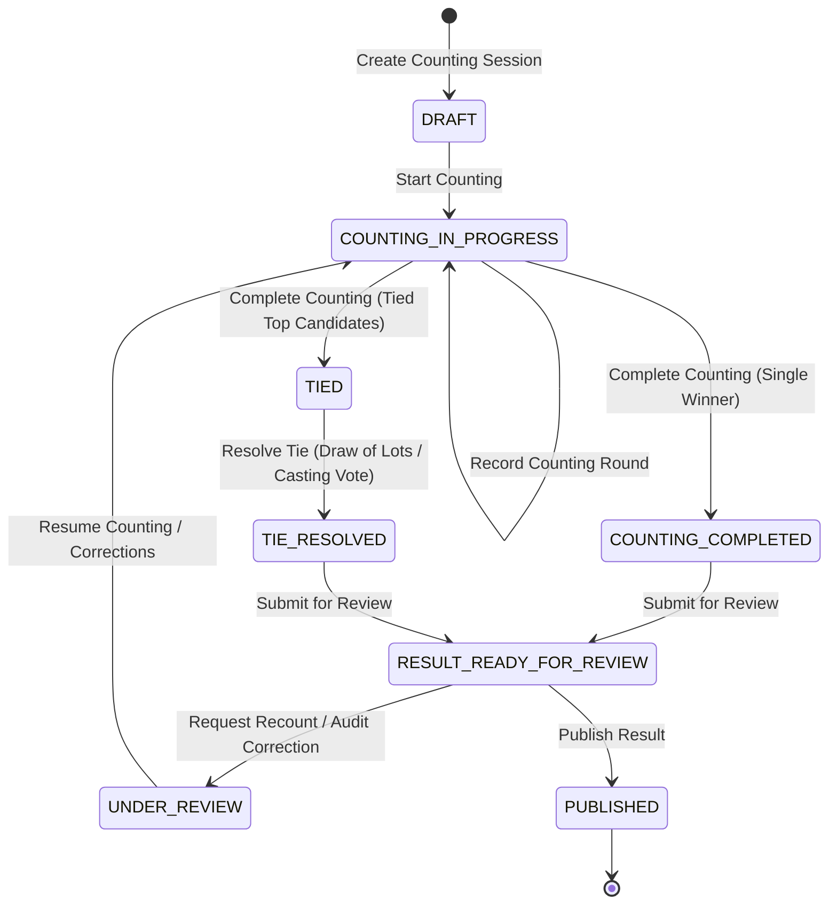

# Result Lifecycle State Machine (Phase 8.9)

## 1. Lifecycle Overview

The result management lifecycle coordinates the progression from uncounted constituency setup to final certified public publication.

---

## 2. State Definitions & Permitted Transitions

| Source State | Destination State | Trigger / Action | Required Permission | Invariants Checked |
|---|---|---|---|---|
| *(initial)* | `DRAFT` | `createSession` | `RESULTS_MANAGE` | Constituency assigned, election active, no duplicate session |
| `DRAFT` | `COUNTING_IN_PROGRESS` | `startCounting` | `RESULTS_TALLY_MANAGE` | Initializes candidate tallies to 0 |
| `COUNTING_IN_PROGRESS` | `COUNTING_IN_PROGRESS` | `recordRound` | `RESULTS_TALLY_MANAGE` | Round sequential, cumulative non-decreasing |
| `COUNTING_IN_PROGRESS` | `COUNTING_COMPLETED` | `completeCounting` | `RESULTS_TALLY_MANAGE` | At least 1 round recorded, unique top candidate |
| `COUNTING_IN_PROGRESS` | `TIED` | `completeCounting` | `RESULTS_TALLY_MANAGE` | $\ge 2$ top candidates with equal highest positive votes |
| `TIED` | `TIE_RESOLVED` | `resolveTie` | `RESULTS_TIE_RESOLVE` | Selected winner must be one of the top tied candidates |
| `COUNTING_COMPLETED` | `RESULT_READY_FOR_REVIEW` | `submitForReview` | `RESULTS_REVIEW` | Winner determined, tallies reconciled |
| `TIE_RESOLVED` | `RESULT_READY_FOR_REVIEW` | `submitForReview` | `RESULTS_REVIEW` | Tie resolution recorded and verified |
| `RESULT_READY_FOR_REVIEW` | `UNDER_REVIEW` | `requestRecount` | `RESULTS_REVIEW` | Recount / review reason documented |
| `UNDER_REVIEW` | `COUNTING_IN_PROGRESS` | `resumeCounting` | `RESULTS_TALLY_MANAGE` | Audit correction history logged |
| `RESULT_READY_FOR_REVIEW` | `PUBLISHED` | `publishResult` | `RESULTS_PUBLISH` | Winner set, DB trigger verifies all candidate tallies |
| `TIE_RESOLVED` | `PUBLISHED` | `publishResult` | `RESULTS_PUBLISH` | Tie resolution present and verified |

---

## 3. Immutability & Protection Rules

1. **Published Session Immutability**:
   - Once a session transitions to `PUBLISHED`, database triggers prevent any modification of candidate tallies, round data, or winner status.
2. **Deletion Protection**:
   - Deletion of counting sessions that have recorded rounds or published results is blocked by database triggers (`protect_counting_session_deletion`).
3. **Audit History Logging**:
   - Every state transition produces an `AdminActionLog` entry with actor ID, IP address, timestamp, previous state, new state, and relevant entity IDs.
