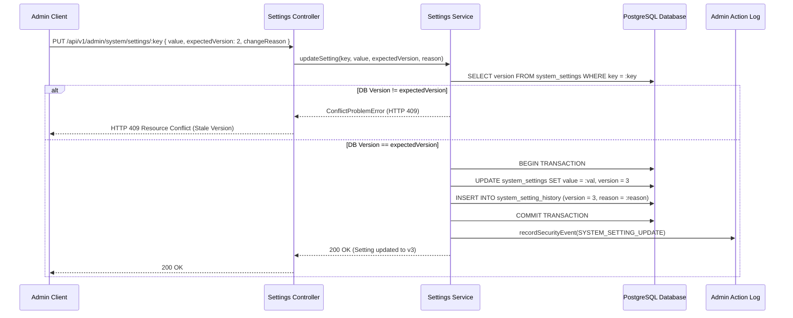

# Centralized System Settings Architecture

## 1. Overview & Purpose
Phase 8.12 introduces a production-grade, centralized system settings module for the Online Voting System (OVS). Rather than allowing arbitrary key-value storage or raw database modifications, the system establishes a strictly typed registry (`SYSTEM_SETTINGS_REGISTRY`) that enforces:

1. **Typed Value Schemas**: All settings define explicit value types (`STRING`, `NUMBER`, `BOOLEAN`, `JSON`).
2. **Safe Code Defaults**: In the event that the database is uninitialized or unseeded, settings resolve to hardcoded safe defaults.
3. **Optimistic Concurrency Control (OCC)**: Every mutation requires an `expectedVersion` argument matching the database version; conflicts return HTTP 409 (`ConflictProblemError`).
4. **Immutable Version History**: Updates increment the version number and append an entry to `SystemSettingHistory` containing the previous value, new value, change reason, and admin ID.
5. **Rollback Mechanism**: Rollback operations never overwrite history; instead, they create a new incremental version tagged with a rollback explanation.
6. **Strict Separation of Secrets**: Database settings **never** store passwords, API keys, or session secrets. Secrets remain strictly in `.env` validated by Zod at startup.

---

## 2. Setting Categories & Catalog

| Category | Setting Key | Type | Default Value | Description | Public |
| :--- | :--- | :--- | :--- | :--- | :--- |
| **PLATFORM** | `platform.siteName` | STRING | Online Voting System (ECI Simulation) | Platform brand name in headers | Yes |
| **PLATFORM** | `platform.tagline` | STRING | Official Educational Simulation Platform of the Election Commission of India | Platform subtitle | Yes |
| **PLATFORM** | `platform.supportEmail` | STRING | support-ovs@eci.gov.in.demo | Support contact email | Yes |
| **PLATFORM** | `platform.allowDemoDataReset` | BOOLEAN | true | Permits authorized admins to reset demo data | No |
| **ELECTION_OPERATIONS** | `election.defaultNominationWindowDays` | NUMBER | 14 | Default duration in days for candidate nomination | No |
| **ELECTION_OPERATIONS** | `election.defaultScrutinyWindowDays` | NUMBER | 2 | Duration in days for nomination scrutiny | No |
| **ELECTION_OPERATIONS** | `election.defaultWithdrawalWindowDays` | NUMBER | 2 | Duration in days for nomination withdrawal | No |
| **ELECTION_OPERATIONS** | `election.enforceStrictPhaseOrdering` | BOOLEAN | true | Enforces chronological lifecycle transitions | No |
| **VOTING** | `voting.allowVoteReceiptDownload` | BOOLEAN | true | Allows voter participation receipt download | Yes |
| **VOTING** | `voting.demoParticipationCooldownMinutes` | NUMBER | 0 | Cooldown in minutes before re-casting simulated vote | No |
| **VOTING** | `voting.showRealtimeParticipationCounter` | BOOLEAN | true | Shows live participation stats on public dashboards | Yes |
| **SECURITY** | `security.maxFailedLoginAttempts` | NUMBER | 5 | Max failed auth attempts before lockout | No |
| **SECURITY** | `security.accountLockoutDurationMinutes` | NUMBER | 15 | Lockout duration in minutes | No |
| **SECURITY** | `security.sessionTimeoutMinutes` | NUMBER | 60 | Inactivity session timeout in minutes | No |
| **NOTIFICATIONS** | `notifications.enableEmailChannel` | BOOLEAN | false | Enables external email delivery | No |
| **NOTIFICATIONS** | `notifications.batchWorkerIntervalSeconds` | NUMBER | 30 | Polling interval for background notification worker | No |
| **DEMO_SIMULATION** | `demo.bannerDisclaimerText` | STRING | DEMO NOTICE: This is an educational voting simulation... | Educational disclaimer banner text | Yes |
| **DEMO_SIMULATION** | `demo.acceleratedClockMultiplier` | NUMBER | 1 | Time acceleration multiplier for demo timeline | No |
| **DEMO_SIMULATION** | `demo.enableSimulatedCountingTally` | BOOLEAN | true | Permits synthetic demo tally generation | No |

---

## 3. Optimistic Concurrency Control & Rollback

---

## 4. Atomic Bulk Updates
The endpoint `PUT /api/v1/admin/system/settings/bulk` enables administrators to modify multiple settings simultaneously. In accordance with ACID principles, the batch is pre-validated in its entirety before any write operation is dispatched. If even a single key fails schema validation, is read-only, or presents a version mismatch, the entire batch is rejected with an HTTP 409 or HTTP 400 error, leaving all database records unmodified.
