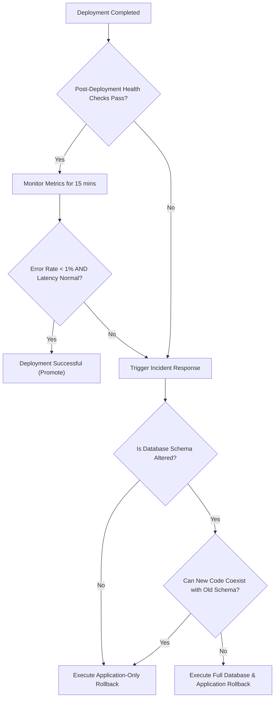

# OVS Application, Schema & Database Rollback Procedures

This document provides actionable procedures for safely rolling back releases when post-deployment verification fails.

---

## 1. Rollback Decision Matrix



---

## 2. Application-Only Rollback (No Schema Changes)

When the release introduced code bugs or regressions, but did not alter the database schema:

### Blue/Green or Tagged Container Reversion
1. Revert container image tag to the previously running version:
   ```bash
   PREVIOUS_VERSION="v1.0.0"
   docker tag ovs-backend:${PREVIOUS_VERSION} ovs-backend:latest
   docker tag ovs-frontend:${PREVIOUS_VERSION} ovs-frontend:latest
   ```
2. Restart backend and frontend services with zero downtime:
   ```bash
   docker compose -f docker-compose.production.yml up -d --no-deps backend-api frontend-proxy
   ```
3. Verify `/api/v1/health` and run the synthetic smoke benchmark:
   ```bash
   node scripts/perf/smoke-perf.mjs
   ```

---

## 3. Database Schema Rollback (Expand-and-Contract)

Because OVS follows the expand-and-contract migration discipline:
- New columns in the **Expand** phase are always nullable or have default values.
- Reverting the application to the previous version requires **no immediate database downtime**, as previous code simply ignores new columns.

### Rolling Back Prisma Migrations
If a migration must be reverted in PostgreSQL:
1. Identify the migration name from `_prisma_migrations`:
   ```bash
   npx prisma migrate status --schema=backend/prisma/schema.prisma
   ```
2. Mark the migration as rolled back in Prisma's tracking table:
   ```bash
   npx prisma migrate resolve --rolled-back "<MIGRATION_NAME>"
   ```
3. Apply corresponding down-migration DDL:
   ```sql
   ALTER TABLE "elections" DROP COLUMN IF EXISTS "new_experimental_field";
   ```

---

## 4. Full Database Disaster Rollback (Restore from Snapshot)

If a migration corrupted existing data:
1. Stop backend application containers immediately to halt active writes:
   ```bash
   docker compose -f docker-compose.production.yml stop backend-api
   ```
2. Restore verified pre-deployment backup into `ovs_production`:
   ```bash
   docker exec -i ovs-prod-postgres pg_restore -U ovs_prod_user -d ovs_production --clean --if-exists < backups/pre_deploy_backup.dump
   ```
3. Restart backend with the previous application container image.
4. Verify database consistency and reopen frontend proxy.
